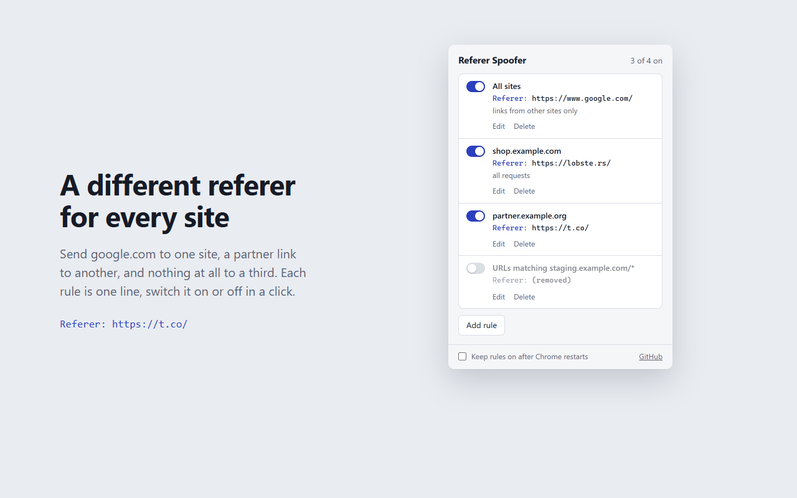

# Referer Spoofer, a Chrome extension to change the HTTP Referer header

**Referer Spoofer** changes or removes the HTTP `Referer` header Chrome sends, for every site or per site. Give each domain its own referer, spoof only links coming from other sites, and test referral traffic, redirects and referer checks.



## Features

- **Per-site referers**: one rule per domain, subdomain or URL pattern (`example.com/shop/*`), plus an optional rule for all sites. A site rule beats the all-sites rule; otherwise the higher rule in the list wins.
- **Set or remove**: send a custom referer URL, or strip the Referer header completely.
- **Links from other sites only**: links inside the same site keep their real referer (same registrable domain, so `www.example.com` and `shop.example.com` count as the same site).
- **Page only or every request**: by default only the page itself gets the new referer. Turn on "Also iframes, images, scripts and API calls" to cover sub-resources, `fetch` and XHR.
- **On/off per rule**, and the active tab reloads after each change.
- **Off after restart**: rules stay in the list but switch off when Chrome restarts or the extension updates, unless "Keep rules on after Chrome restarts" is checked.

The extension changes the header the server receives. The page's own JavaScript (`document.referrer`) still sees the browser's original value.

## Installation

From the [Chrome Web Store](https://chromewebstore.google.com/search/Referer%20Spoofer), or unpacked:

1. `git clone https://github.com/Siin0pe/chrome-referer-spoofer.git`
2. Open `chrome://extensions/` and enable **Developer mode**.
3. Click **Load unpacked** and select the `src` folder.

Requires Chrome 102 or later.

## Usage

1. Click the **Referer Spoofer** icon.
2. Click **Add rule**. Leave **Sites** empty for all sites, or enter domains (comma separated) or one URL pattern. **Use this site** fills in the current tab's domain.
3. Choose **Send this URL** and type the referer, or **Remove it**.
4. Click **Save and reload tab**. The toolbar badge shows how many rules are on.

## Permissions

- **declarativeNetRequest**: rewrites or removes the Referer header according to your rules.
- **storage**: keeps your rules locally.
- **Host access (all sites)**: Chrome only lets an extension modify request headers on sites it has access to, and a rule can target any site.

No data is collected or sent anywhere.

## Development

```bash
node test/rules.test.mjs   # rule parsing and conversion to declarativeNetRequest rules
```

Rules are stored in `chrome.storage.local` and mirrored as declarativeNetRequest session rules (`src/rules.js`). Store screenshots and listing text live in `store/`.

## License

MIT. See [LICENSE](LICENSE).

Use responsibly and in line with each website's terms of service.
